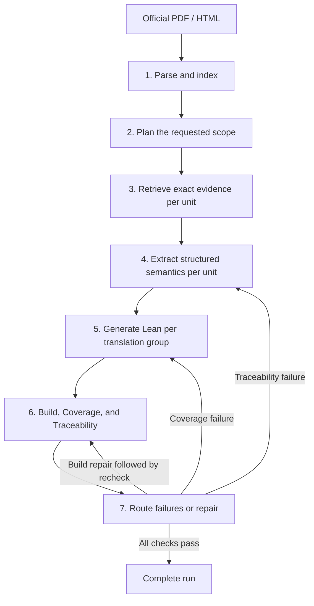

# Spec2Lean

Spec2Lean turns official PDF and HTML specifications into evidence-backed **Lean
4 code**. It makes the path from source text to generated code inspectable: each
Lean declaration is linked to semantic claims, those claims cite evidence, and
that evidence points to exact specification nodes and source locations.

The project combines a Python pipeline, a local SQLite specification index,
bounded model sessions, deterministic artifact validators, Lean compilation, and
a browser-based artifact explorer. It supports selecting individual instructions,
a specification-defined family, a source subtree, or the full specification.
Units can describe protocol constructs as well as ISA instructions; TileLink,
PTX, and x86 examples are included below.

Current release: **1.0.0**. See [CHANGELOG.md](CHANGELOG.md).

## How the project works



The pipeline owns scheduling, artifact storage, freshness checks, and resume.
Models propose plans, evidence selections, semantics, and Lean. Deterministic
code validates their submissions before publishing artifacts. Related units share
specification-derived translation groups, so common types and declarations can
be defined once and mapped to claims from multiple units.

A passing run establishes Lean compilation and the implemented coverage and
traceability contracts. It does not establish a proof that every interpretation
of the original prose is correct. Claims, assumptions, and their source links
remain available for review.

## Two independent choices: runtime and retrieval

`--runtime` chooses **who manages model sessions and tool calls**.
`--index-mode` chooses **how specification search results are ranked**.

| Flag | Options | Default |
| --- | --- | --- |
| `--runtime` | `rust-harness`, `opencode` | `rust-harness` |
| `--index-mode` | `lexical`, `semantic` | `lexical` |

These defaults apply when neither a flag nor its corresponding environment
variable is set. All four combinations are supported. Changing a runtime or
retrieval mode preserves the pipeline's phases, prompts, artifact schemas,
validation rules, and GUI traceability contracts; model-generated results can
still differ between runs.

### Rust harness

With `--runtime rust-harness`, Spec2Lean's Rust code controls the bounded tool
loop: dispatching allowed phase tools, returning validation feedback to the model,
enforcing step limits, recording transcripts, and ending on an accepted
submission. It keeps a persistent Codex MCP conversation within each phase
session. MCP is the structured interface used to exchange requests and tool
results between processes.

The Rust harness currently uses the **Codex CLI** to reach the model. The Python
pipeline supplies the phase's restricted specification and submission tools.
**OpenCode is not used in this mode. Codex and OpenCode are different programs.**
Rust replaces OpenCode's session/tool orchestration; it still needs a model
provider connection through Codex.

### OpenCode

With `--runtime opencode`, the existing OpenCode runtime manages the model session
and its calls to Spec2Lean's restricted phase tools. OpenCode must be installed
and its OpenAI provider authenticated. The Rust binary and Codex CLI are not
required for this mode.

Both runtimes use the configured formalization model
`openai/gpt-5.6-sol` with `medium` reasoning. Runtime selection does not select a
different model. OpenCode checks its model catalog before a session; Rust reports
provider availability errors. Neither silently substitutes a model or falls back
to the other runtime.

## Setup

Run the commands in this README from the repository directory.

### Python and Lean

Python **3.11 or newer** is required:

```bash
python3 -m venv .venv
.venv/bin/pip install -e '.[dev]'
```

The `./spec2lean` wrapper automatically uses `.venv/bin/python`. The `dev` extra
adds the test dependency; use `pip install -e .` if tests are not needed.

Install Lean 4 and make its `lean` executable available in the terminal that runs
Spec2Lean. Phase 6 uses that executable and records its version:

```bash
lean --version
```

### Set up the Rust runtime

Build with Rust **1.88 or newer**:

```bash
cargo build --release --manifest-path harness/Cargo.toml
```

Install and authenticate the [Codex CLI](https://learn.chatgpt.com/docs/codex/cli).
Check it from the same terminal where you will start the pipeline:

```bash
codex --version
codex login status
```

If Codex is already installed outside that terminal's `PATH`, set its absolute
executable path. For example, an editor extension may bundle Codex without making
it available in a normal shell:

```bash
export SPEC2LEAN_CODEX=/absolute/path/to/codex
```

Spec2Lean looks for `spec2lean-harness` on `PATH`, then in this repository's
`harness/target/release/` and `harness/target/debug/` directories. See the
[Rust runtime guide](harness/README.md) for transport details.

### Set up the OpenCode runtime

Install OpenCode, authenticate its OpenAI provider, and verify that the configured
model appears in its catalog:

```bash
opencode --version
opencode models openai
```

Select it explicitly with `--runtime opencode` on a model-running command.

### Enable semantic search

Lexical search is included in the base installation. Semantic search requires
an optional dependency:

```bash
.venv/bin/pip install -e '.[semantic]'
```

The first semantic indexing operation loads/downloads the embedding model.
Embeddings run on CPU; a GPU is not required. This embedding model is separate
from the model used for planning and Lean generation.

## Run a specification

### TileLink 1.9.3

If the source PDF has not been acquired yet, fetch it once:

```bash
documents/sources/sifive/tilelink/1.9.3/fetch.sh
```

The fetch script saves the official PDF and records acquisition metadata and its
checksum. If the local source is already present, proceed directly to the run.

Generate Lean for the full specification with Rust and semantic search:

```bash
./spec2lean run \
  --language tilelink \
  --version 1.9.3 \
  --all \
  --runtime rust-harness \
  --index-mode semantic
```

Phase 1 validates or rebuilds the index and ensures semantic vectors exist. The
remaining phases create or reuse validated artifacts, generate Lean, run checks,
and perform bounded recovery when needed. `--all` explicitly requests the full
specification; it can involve many model sessions.

The other combinations use the same workflow:

```bash
# Rust with lexical search: the default combination.
./spec2lean run --language tilelink --version 1.9.3 --all \
  --runtime rust-harness --index-mode lexical

# OpenCode with lexical search.
./spec2lean run --language tilelink --version 1.9.3 --all \
  --runtime opencode --index-mode lexical

# OpenCode with semantic search.
./spec2lean run --language tilelink --version 1.9.3 --all \
  --runtime opencode --index-mode semantic
```

Fresh matching artifacts may be reused, including when switching runtimes. A new
runtime selection controls newly started sessions; it does not force regeneration
of existing artifacts. Plans created under different index modes are not reused
across those modes.

### A small PTX example

After acquiring the PTX sources, a single instruction gives a smaller experiment:

```bash
documents/sources/nvidia/ptx/9.3/fetch.sh
./spec2lean run --language ptx --version 9.3 --instructions and.b32
```

### An x86 example

The included Intel source acquisition targets revision 092, Volume 2A:

```bash
documents/sources/intel/x86/092/fetch.sh
./spec2lean run --language x86 --version 092 --instructions ADD,AND,CMP,DEC,INC
```

### Choose the scope

Every `run` or `plan build` command requires exactly one scope selector:

| Selector | Meaning | Example |
| --- | --- | --- |
| `--instructions` | Exact names, separated by commas | `--instructions add.u32,sub.u32` |
| `--family` | A family resolved from the specification | `--family "integer arithmetic instructions"` |
| `--source-node` | An indexed node and its subtree | `--source-node node:ACTUAL_NODE_ID` |
| `--all` | The full specification | `--all` |

Use `index search`, `index tree`, and `index show` to inspect actual source nodes
before choosing a subtree. The Planner resolves units from indexed source
structure and validates their relationship to the request.

## The seven phases

| Phase | Main responsibility | Main output | Model session? |
| --- | --- | --- | --- |
| 1. Parse + Index | Parse official sources, preserve structure and provenance, build search indexes | SQLite database, index manifest, PDF page text; optional vectors | No formalization model; semantic mode uses an embedding model |
| 2. Planner | Resolve scope, dependencies, processing order, and translation groups | `plan.json`, `plan.md`, session metadata | Yes |
| 3. Evidence Retriever | Select relevant exact source nodes/spans per unit | `evidence.json`, `evidence.md`, retrieval metadata | Yes |
| 4. Semantic Extractor | Describe behavior and classify evidence-linked claims; handle missing evidence | `semantics.json`, `semantics.md`, recovery records | Yes |
| 5. Translator | Translate each complete semantic group into Lean 4 | `<Group>.lean`, translation manifest, session metadata | Yes |
| 6. Check | Compile Lean and verify forward coverage and reverse traceability | `check.json`, `check.md` | No |
| 7. Troubleshooter | Route failures to the responsible phase and perform bounded repair/revision | Routing, repair, and resolution records | When repair/revision is needed |

### 1. Parse + Index

PyMuPDF extracts PDF text, layout, pages, and bounding boxes. HTML parsing retains
headings, anchors, DOM locations, and source lines. SQLite stores the hierarchy,
node IDs, source spans, definitions, cross-references, and source hashes. FTS5
provides lexical search. Semantic mode adds vectors to the same database.

An index is reused only when its structure, parser/schema versions, source hashes,
and PDF page-text companions validate. Rebuilding uses the local official source
files identified by the source manifest. See [Phase 1](docs/phase-1-design.md).

### 2. Planner

The Planner works within the resolved request. It proposes dependencies and
translation groups supported by indexed specification structure. Validation checks
unit identity, group membership, source support, and graph structure, then derives
processing layers. External prerequisites are recorded separately; genuine cycles
remain represented. See [Phase 2](docs/phase-2-design.md).

### 3. Evidence Retriever

Each unit gets a bounded retrieval session. The model selects exposed node/span
IDs and explains their relevance. Deterministic code supplies exact quotations,
evidence IDs, source hashes, URLs, and PDF/HTML provenance. A model cannot replace
the canonical source text with an invented quotation.

The result separates core and supporting evidence. See
[Phase 3](docs/phase-3-design.md).

### 4. Semantic Extractor and Open Question Handler

The extractor reads the unit's evidence through `get_evidence` and submits
structured semantics through `submit_semantics`. It records inputs, outputs,
operations, state effects, constraints, edge cases, dependencies, and claims as
applicable. Claim classes are `SOURCE_FACT`, `DERIVED_INTERPRETATION`,
`DESIGN_DEPENDENCY`, and `ASSUMPTION`.

If evidence is insufficient, a separate handler searches the canonical index
first. Any permitted internet evidence, configured runtime probe, or LLM reasoning
fallback is explicitly non-normative; claims relying on it must be assumptions.
Validated augmentation can start a fresh extraction attempt. Unresolved questions
stop progress. Recovery defaults to two rounds. See [Phase 4](docs/phase-4-design.md).

### 5. Lean Translator

The Translator receives accepted semantics for every member of one planned group.
One bounded session submits one complete `<Group>/<Group>.lean` file and its
translation manifest. Shared types and declarations can serve several units;
manifest references identify the responsible `(unitId, claimId)` pairs.

Validation enforces the Lean submission and declaration-mapping contracts before
publishing the result. See [Phase 5](docs/phase-5-design.md).

### 6. Build, Coverage, and Traceability

Three independent responsibilities are checked:

- **Build:** compile the complete group file with Lean and capture diagnostics.
- **Coverage:** verify that each semantic claim maps to a declaration present in
  the generated group, and account for evidence attached to those claims.
- **Traceability:** follow declarations back through claims and evidence to valid
  source documents, nodes, and spans; detect broken references and stale inputs.

The group is compiled once and results are recorded for its member units. Check
uses no model and does not repair code. See [Phase 6](docs/phase-6-design.md).

### 7. Troubleshooter and bounded recovery

Routing follows the earliest responsible phase: traceability failures return to
semantics, coverage failures return to translation, and build-only failures use a
compiler-guided repair session. All-pass requires no action.

`troubleshoot run` performs one routing/repair action. `troubleshoot resolve` and
the full pipeline follow the bounded revision chain, rerunning Phase 6 after each
action. Recovery stops on success, repeated lack of progress, or the dispatch
limit, which defaults to eight. See [Phase 7](docs/phase-7-design.md).

## Lexical and semantic search

| Aspect | `lexical` | `semantic` |
| --- | --- | --- |
| Ranking | SQLite FTS5 keyword/full-text ranking | Embedding similarity with cosine ranking |
| Typical query | An exact term, mnemonic, or phrase from the source | A concept or paraphrase whose wording may differ |
| Extra dependency/model | None beyond the base installation | `sentence-transformers` and embedding weights |
| Source identity | Canonical node IDs and provenance | The same canonical node IDs and provenance |
| Hierarchy/navigation | Available | Available |

Semantic similarity helps locate passages; it does not make them evidence by
itself. The retriever still reads exact source nodes/spans, and all later evidence
and mapping validators remain in force. Direct node and subtree navigation is
available in either mode and does not require a ranked search.

The default embedding model is `sentence-transformers/all-MiniLM-L6-v2`. Vectors,
model/revision information, and freshness metadata are stored in SQLite. A worker
caches the model across queries. Long node text is capped for embedding/ranking;
the canonical source text is retained for evidence.

Build a source index explicitly, then compare the searches:

```bash
./spec2lean index build --language tilelink --version 1.9.3 \
  --pdf documents/sources/sifive/tilelink/1.9.3/raw/tilelink_spec_1.9.3.pdf

./spec2lean index search --language tilelink --version 1.9.3 \
  --index-mode lexical --query Get

./spec2lean index embed --language tilelink --version 1.9.3

./spec2lean index search --language tilelink --version 1.9.3 \
  --index-mode semantic --query 'reading data from a memory address'
```

For PDF and HTML together, pass both `--pdf FILE.pdf` and `--html FILE.html` to
`index build`. Add `--index-mode semantic` to build vectors at the same time.
A full `run --index-mode semantic` ensures vectors automatically; a standalone
semantic search requires valid existing vectors and reports missing, stale, or
corrupt data instead of silently using lexical search.

The search selector is available on `run`, `index build`, `index search`,
`plan build`, `evidence build`, `semantics build`, and `troubleshoot resolve`.
See the [semantic index guide](docs/semantic-index.md) for model selection and
storage details.

## Progress, status, and resume

Progress goes to stderr; the final run manifest is JSON on stdout. Logs identify
the pipeline run, current phase/unit/group, artifact reuse, elapsed time, check
results, and recovery actions. `run.json` preserves per-phase and per-attempt
elapsed times across resumes.

Replace placeholders below with IDs printed by your run. Pipeline run IDs
(`pipeline-run:...`) and plan IDs (`plan:...`) identify different artifacts.

```bash
./spec2lean status --run PIPELINE_RUN_ID
./spec2lean plan show --run PLAN_RUN_ID
./spec2lean plan units --run PLAN_RUN_ID
./spec2lean plan groups --run PLAN_RUN_ID
./spec2lean plan layers --run PLAN_RUN_ID
```

Resume a particular TileLink semantic run by repeating its scope and index mode:

```bash
./spec2lean run --language tilelink --version 1.9.3 --all \
  --runtime rust-harness --index-mode semantic --resume PIPELINE_RUN_ID
```

Use `--resume` without an ID for the latest compatible run. The same language,
version, scope, and index mode are required. Ctrl-C records an interrupted run
and prints its resume ID. Resume validates input hashes and source identity before
reusing plans, evidence, semantics, translations, or checks. A fresh invocation
can also reuse a matching plan and its valid artifacts; omitting `--resume` does
not mean “regenerate everything.”

| Option | Purpose | Default |
| --- | --- | --- |
| `--dry-run` | Report projected reuse/work without writing artifacts or starting a model | Off |
| `--from PHASE` | First phase allowed to create artifacts; earlier artifacts must be fresh | `index` |
| `--until PHASE` | Last phase to execute | `troubleshoot` |
| `--timeout SECONDS` | Timeout for each bounded model session, not the whole pipeline | `1800` |
| `--max-question-rounds N` | Limit evidence-recovery rounds | `2` |
| `--max-dispatches N` | Limit Phase-7 routing actions per unit | `8` |

Phase names are `index`, `plan`, `evidence`, `semantics`, `translate`, `check`,
and `troubleshoot`. For example:

```bash
./spec2lean run --language tilelink --version 1.9.3 --all \
  --index-mode semantic --dry-run
```

## Inspect artifacts and run individual phases

These inspection commands read stored results without starting model sessions:

```bash
./spec2lean index stats --language tilelink --version 1.9.3
./spec2lean index tree --language tilelink --version 1.9.3 --max-depth 3
./spec2lean index show --node NODE_ID
./spec2lean index children --node NODE_ID
./spec2lean index ancestors --node NODE_ID
./spec2lean index subtree --node NODE_ID

./spec2lean evidence show --plan-run PLAN_RUN_ID --unit UNIT_ID
./spec2lean evidence provenance --evidence EVIDENCE_ID
./spec2lean semantics show --plan-run PLAN_RUN_ID --unit UNIT_ID
./spec2lean semantics claims --plan-run PLAN_RUN_ID --unit UNIT_ID
./spec2lean semantics questions --plan-run PLAN_RUN_ID --unit UNIT_ID
./spec2lean translate show --plan-run PLAN_RUN_ID --unit UNIT_ID
./spec2lean translate manifest --plan-run PLAN_RUN_ID --unit UNIT_ID
./spec2lean check show --plan-run PLAN_RUN_ID --unit UNIT_ID
./spec2lean check coverage --plan-run PLAN_RUN_ID --unit UNIT_ID
./spec2lean check traceability --plan-run PLAN_RUN_ID --unit UNIT_ID
./spec2lean troubleshoot resolution --plan-run PLAN_RUN_ID --unit UNIT_ID
./spec2lean trace --declaration QUALIFIED_LEAN_DECLARATION
```

To operate phase by phase, create a plan and use the IDs it returns:

```bash
./spec2lean plan build --language ptx --version 9.3 --instructions and.b32
./spec2lean evidence build --plan-run PLAN_RUN_ID --unit UNIT_ID
./spec2lean semantics build --plan-run PLAN_RUN_ID --unit UNIT_ID
./spec2lean translate build --plan-run PLAN_RUN_ID --group GROUP_FROM_PLAN
./spec2lean check run --plan-run PLAN_RUN_ID --unit UNIT_ID
./spec2lean troubleshoot resolve --plan-run PLAN_RUN_ID --unit UNIT_ID
```

Pass `--runtime opencode` to model-running commands if that is your selected
runtime. Keep the appropriate `--index-mode` on retrieval-capable commands when
using semantic search. `translate build --unit UNIT_ID` selects the entire group
containing that unit. `evidence build` accepts repeated `--unit` selectors and an
optional `--jobs N`; omitting units from evidence/semantics builds processes all
eligible units in the plan.

Standalone creation commands expect their prerequisite artifacts to exist.
Separate `semantics revise`, `translate revise`, and `check recheck` commands
support bounded repair workflows. Use `./spec2lean --help` or a subcommand's
`--help` for its arguments.

## Explore results in the GUI

```bash
./spec2lean gui
# Or open a particular run:
./spec2lean gui --run PIPELINE_RUN_ID --port 8080
```

The default address is `http://127.0.0.1:8000`; use port 8080 for the second
example. The explorer includes complete, partial, and failed runs. It is read-only
and does not start pipeline phases.

Its central navigation follows:

```text
Lean declaration → semantic claim → evidence → exact source provenance
```

The GUI also provides reverse mappings, shared group declaration traceability,
Build/Coverage/Traceability views, and run/unit navigation. PDF previews highlight
recorded source bounding boxes; HTML evidence retains its source anchors and
locations. When a unit's evidence includes both official renditions, factual and
derived claims must cite both, preserving the links visible in the explorer.
See the [GUI guide](docs/gui.md).

## Where files live

`<language>` is stored in lowercase. Most generated phase artifacts are grouped by
language, version, and plan ID; the top-level run manifest uses a pipeline run ID.

| Location | Contents |
| --- | --- |
| `documents/sources/<publisher>/<language>/<version>/` | Official source acquisition scripts, checksums, source manifest, and local `raw/` files |
| `indexes/<language>/<version>/` | `specification.sqlite`, `index-manifest.json`, and `text/*.pages.txt`; optional vectors live in SQLite |
| `plans/<language>/<version>/<plan-id>/` | Request, accepted plan, readable plan, and Planner session metadata |
| `evidence/<language>/<version>/<plan-id>/<unit>/` | Evidence bundle, readable evidence, and retrieval metadata |
| `semantics/<language>/<version>/<plan-id>/<unit>/` | Structured semantics, readable semantics, extractor metadata, and recovery attempts |
| `translations/<language>/<version>/<plan-id>/<Group>/` | `<Group>.lean`, `translation-manifest.json`, and Translator metadata |
| `checks/<language>/<version>/<plan-id>/<unit>/` | Build, coverage, and traceability reports |
| `troubleshooting/<language>/<version>/<plan-id>/<unit>/` | Routing, repair, and bounded resolution artifacts |
| `runs/<language>/<version>/<pipeline-run-id>/run.json` | Overall progress, artifact references, timing, and terminal status |

Generated indexes and phase outputs are Git-ignored. Source manifests and checksums
provide reproducible input identity. PDF text companions preserve page delimiters
and can be searched directly, while SQLite remains authoritative for hierarchy
and provenance.

For a new specification, `index build` accepts explicit PDF/HTML paths. To let the
full pipeline rebuild from official inputs, provide a matching source manifest
under `documents/sources/`, following an existing example, with local paths,
source URLs, and SHA-256 hashes.

## Configuration and troubleshooting

| Setting | Purpose |
| --- | --- |
| `SPEC2LEAN_RUNTIME` | Default runtime when `--runtime` is omitted |
| `SPEC2LEAN_INDEX_MODE` | Default retrieval mode when `--index-mode` is omitted |
| `SPEC2LEAN_CODEX` | Codex executable name or absolute path for the Rust provider |
| `SPEC2LEAN_RUNTIME_PROBE_COMMAND` | Optional trusted JSON-stdin adapter used by open-question recovery; unrelated to choosing Rust/OpenCode |

Explicit runtime and index flags take precedence over their environment defaults.

- **Codex executable missing:** verify its path in the terminal running Spec2Lean
  or set `SPEC2LEAN_CODEX`. Codex is the Rust mode's model connection; installing
  OpenCode does not fix that dependency. Resume the same run after setup.
- **Rust harness missing:** build `harness/Cargo.toml` in release mode or put the
  compiled `spec2lean-harness` on `PATH`.
- **Required model unavailable:** configure access to the exact formalization
  model; Spec2Lean does not choose another model automatically.
- **Semantic vectors missing or stale:** use `index embed` on an existing valid
  index, or let `run --index-mode semantic` ensure them in Phase 1.
- **Failed phase:** inspect `status`, the phase's session metadata, and its captured
  stderr/transcript. Correct the cause, then resume with the same scope and mode.
- **Lean not found:** make `lean` available in the run's terminal; Phase 6 records
  compiler availability failures in the Build result.

## Development and further reading

The Python pipeline is in `src/spec2lean/`, the Rust runtime is in `harness/`,
public JSON contracts are in `schemas/`, and deterministic regression tests are
in `tests/`.

```bash
.venv/bin/pytest
cargo test --manifest-path harness/Cargo.toml
cargo fmt --all --manifest-path harness/Cargo.toml --check
cargo clippy --manifest-path harness/Cargo.toml --all-targets -- -D warnings
```

Build the runtime first to include the Python/Rust bridge tests:

```bash
cargo build --manifest-path harness/Cargo.toml
.venv/bin/pytest tests/test_runtime.py tests/test_embeddings.py
```

Deterministic tests use fixtures and provider doubles. Actual model-driven runs,
real Lean compilation, and browser interaction are separate integration checks.
The [integration audit](docs/supervisor-integration-report.md) records the initial
Rust/semantic integration and its lexical/semantic end-to-end validation.

Further details: [pipeline runner](docs/pipeline-runner-design.md),
[phase designs](docs/phase-1-design.md), [runtime](harness/README.md),
[semantic retrieval](docs/semantic-index.md), and [GUI](docs/gui.md).
